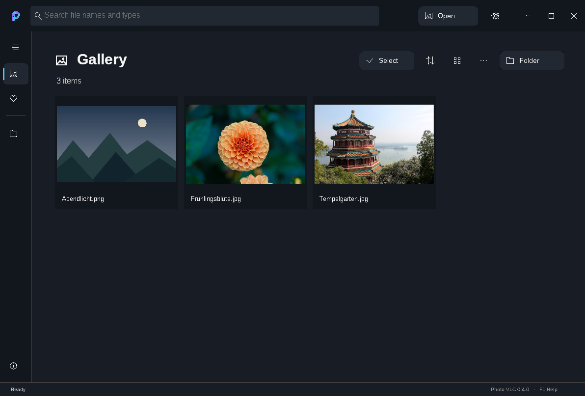
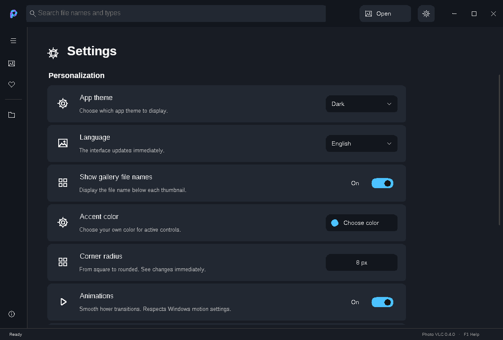

# Photo VLC

Ein kleiner, nativer Foto-Betrachter für **Windows 10/11 x64**, geschrieben in
C++17. Galerie mit Suche und Favoriten, deutsche und englische Oberfläche,
System-/Hell-/Dunkel-Design, keine Browser-Runtime und kein Account.

> **Photo VLC 0.4.0** ist eine Galerie und ein Foto-Betrachter. Die Unterstützung für jedes
> Design-, CAD- oder Spieleformat ist noch nicht vollständig. Alle 194 Endungen sind im
> Dateifilter erfasst; die tatsächliche Unterstützung steht in
> [docs/formats.md](docs/formats.md).





Die Abbildung zeigt den tatsächlichen Windows-Build unter Wine.
Bildnachweise für die gezeigten Testfotos: [docs/screenshots.md](docs/screenshots.md).

## Download

Unter [Releases](https://github.com/Lyvt-Dev/Foto-VLC/releases) gibt es
`setup.exe` für eine Installation ohne Administratorrechte mit Codecs, Startmenü-Eintrag,
optionalem Desktop-Symbol und „Öffnen mit“-Registrierung. Alternativ gibt es
`PhotoVLC-Windows-x64.zip` als vollständige portable App mit zusätzlichen Decodern.
ZIP vollständig entpacken und `PhotoVLC.exe` starten. Das `codecs`-Verzeichnis
bleibt neben der EXE. Die einzelne `PhotoVLC.exe` ist der kleinere Download
mit eingebauten Decodern und Unterstützung für installierte Windows-Codecs. Die EXE benötigt keine Installation und keine zusätzliche
C++-Runtime. Der Build ist bislang nicht mit einem Code-Signing-Zertifikat
signiert. Die Prüfsumme steht im jeweiligen Release.

## Funktionen

- Eigenes Blenden-P-Logo, flache Controls ohne Tiefeneffekt und dezente Hover-Animationen.
- Frei wählbare Akzentfarbe, Eckenradius (0–16 px), Animationen und JPEG-Qualität.
- Echte Konvertierung als Kopie: PNG, JPEG, BMP, TIFF und verlustfreies WebP (Strg+S).
- Drehen und Spiegeln werden beim Export übernommen; Originaldateien können nicht überschrieben werden.
- Bild in die Zwischenablage kopieren (Strg+C), spiegeln (M), Ansicht zurücksetzen.
- Galerie optional mit Unterordnern (maximal 10.000 Bilder; Verzeichnislinks werden nicht verfolgt).

- Datei oder Ordner öffnen; Dateien und Ordner per Drag-and-drop laden.
- Filmstreifen mit echten Vorschaubildern und natürlicher Dateisortierung (Bild 2 vor Bild 10).
- Galerie mit mehreren Bilderordnern, Suche nach Dateiname/Endung und drei Vorschaugrößen.
- Favoriten, Mehrfachauswahl und ausklappbare Navigation.
- Einstellungen mit Deutsch/Englisch/Systemsprache, System-/Hell-/Dunkel-Design und Zoom-Voreinstellung.
- Automatische Übernahme der bisherigen Foto-VLC-Einstellungen.
- Kompakte Werkzeugleiste, native Windows-Schaltflächen und Hinweise beim Darüberfahren.
- Anpassen, Originalgröße, Zoom auf die Mausposition und Verschieben durch Ziehen.
- Doppelklick wechselt zwischen angepasster Ansicht und Originalgröße.
- In 90°-Schritten drehen, Vollbild, Diashow mit vier Sekunden pro Bild.
- Bilddetails bei Bedarf einblenden: Dateiname, Format, Größe, Auflösung und Änderungsdatum.
- Datei im Explorer anzeigen oder ihren Pfad kopieren.
- Sichtbare Versionsnummer und eigene Hilfeansicht mit Tastenkürzeln und Formatübersicht.
- Fenstergröße, Detailansicht und Filmstreifen werden für den nächsten Start gespeichert.
- Transparenzraster, Unicode-Dateinamen und an die Display-Skalierung angepasste UI.
- Bilder im Hintergrund laden; veraltete Ladeergebnisse werden verworfen.
- PNG, JPEG/JFIF, BMP/DIB, GIF, TIFF, ICO über Windows WIC.
- WebP (auch erste Animationsframes), SVG-Formen, PSD-Komposit, TGA, PGM/PPM, PIC und QOI über eingebettete Decoder.
- Zusätzliche Decoder im vollständigen ZIP, automatisch erkannt: geprüfte AVIF-, HEIC-, JXL-, JP2-, EXR-, DDS- und PCX-Dateien einschließlich Galerie-Vorschau.
- Weitere RAW-/Raster-/Vektorformate über das Decoder-Paket, abhängig von Variante und Kameramodell.

Originaldateien werden nicht verändert. Drehen und Zoom betreffen nur die Anzeige.
GIFs, APNGs und mehrseitige Dateien zeigen die erste decodierbare Seite; Animation
und Ebenenbearbeitung gehören nicht zu v0.3. Die Diashow wechselt zwischen Dateien.

## Bedienung

| Aktion | Taste |
| --- | --- |
| Konvertieren / Bild kopieren | Strg+S / Strg+C |
| Horizontal spiegeln | M |
| Datei / Ordner öffnen | Strg+O / Strg+Umschalt+O |
| Vorheriges / nächstes Bild | ← / → |
| Einpassen / 1:1 | F / 1 |
| Zoom | Mausrad oder + / − |
| Drehen / Informationen | R / I |
| Filmstreifen | T |
| Zwischen Anpassen und 1:1 wechseln | Doppelklick |
| Hilfe | F1 |
| Vollbild | F11 |
| Diashow | Leertaste |
| Hilfe/Einstellungen/Vollbild/Diashow verlassen oder Galerie öffnen | Esc |
| Schaltflächen auswählen / auslösen | Tab, Umschalt+Tab / Enter |

Ein Dateipfad kann auch als Startargument übergeben werden:

```powershell
.\PhotoVLC.exe 'C:\Fotos\Mein Bild.png'
```

## Zusätzliche Decoder

Das vollständige ZIP enthält bereits ein portables **ImageMagick 7.1.2-33** in
`codecs/`. Es wird ohne zusätzliche Installation erkannt. Lizenz, Herkunft,
getestete Formate und das separate Quellcodepaket stehen in [docs/codecs.md](docs/codecs.md).
Wer nur die einzelne EXE verwendet, kann zusätzlich ImageMagick installieren:
https://imagemagick.org/script/download.php#windows . Photo VLC findet
`magick.exe` neben der App in `codecs/`, im PATH oder über `PHOTO_VLC_MAGICK`.
Die bisherige Variable `FOTO_VLC_MAGICK` bleibt kompatibel.

```powershell
$env:PHOTO_VLC_MAGICK = 'C:\Program Files\ImageMagick-7.x.x-Q16-HDRI\magick.exe'
.\PhotoVLC.exe
```

Das ist ein Beispielpfad; verwende den tatsächlichen Installationspfad. Unter
„Info & Hilfe → Dateiformate“ steht, ob ImageMagick gefunden wurde. Mit
`magick identify -list format` kann die installierte Decoderliste geprüft werden.
PDF/EPS/PS und manche AI-Dateien brauchen ggf. Ghostscript. Die App ändert keine
ImageMagick-Sicherheitsrichtlinien. Formate, für die kein Decoder vorhanden ist,
zeigen eine verständliche Fehlermeldung.

## Lokale Einstellungen

Galerieordner, Favoriten, Sprache, Design, Ansichtsoptionen und zuletzt
erfolgreich geöffnete Bilder liegen ausschließlich
auf diesem Gerät unter `%LOCALAPPDATA%\PhotoVLC\settings.ini`. Der Verlauf lässt
sich in den Einstellungen löschen. Die Galerie kopiert keine Fotos und das
Entfernen eines Galerieordners löscht keine Dateien. Pro hinzugefügtem Ordner
werden direkt enthaltene Bilder erfasst; Unterordner können separat ergänzt
werden. Die Galerie indexiert bis zu 10.000 erkannte Dateien.
Die Unicode-Datei wird atomar ersetzt, damit auch internationale Dateinamen
korrekt erhalten bleiben. Es werden keine Bilder in die App kopiert.

## Selbst bauen

Mit Visual Studio 2022 Build Tools, Windows SDK und CMake ≥ 3.20:

```powershell
cmake -S . -B build -A x64
cmake --build build --config Release --parallel 2
ctest --test-dir build -C Release --output-on-failure
$p = Start-Process build/Release/PhotoVLC.exe -ArgumentList '--self-test','windows-self-test.txt' -Wait -PassThru
Get-Content windows-self-test.txt
if ($p.ExitCode -ne 0) { throw 'Windows self-test failed' }
```

Die EXE liegt anschließend in `build/Release/PhotoVLC.exe`. MSVC-Runtime und die
kleinen Decoder werden statisch eingebunden; nur Windows-System-DLLs werden benötigt.

Unter Linux lassen sich die portablen Decoder- und Core-Tests ausführen:

```sh
cmake -S . -B build/native -DCMAKE_BUILD_TYPE=Release
cmake --build build/native --parallel 2
ctest --test-dir build/native --output-on-failure
```

Ein Windows-Cross-Build mit installiertem MinGW-w64 ist ebenfalls möglich:

```sh
cmake -S . -B build/mingw -DCMAKE_SYSTEM_NAME=Windows \
  -DCMAKE_C_COMPILER=x86_64-w64-mingw32-gcc \
  -DCMAKE_CXX_COMPILER=x86_64-w64-mingw32-g++ -DCMAKE_BUILD_TYPE=Release
cmake --build build/mingw --parallel 2
```

Der GitHub-Workflow prüft die portablen Tests sowie die echten WIC-Decoder,
Pixelwerte, Unicode-Pfade, GDI+-Darstellung, Vorschaubilder, native Klick- und
Tastaturbedienung, Einstellungen und Versionsinformationen auf Windows.
Er prüft außerdem Suche, Favoriten, Themes, Sprachwechsel und 100/150/200-%-Skalierung.
Der Codec-Test lädt echte Bilddateien und prüft Pixelwerte und Vorschaubilder.
Bei einem `v*`-Tag veröffentlicht er erst nach bestandenen Tests ein Release,
mit einem separaten Quellcodepaket für den unveränderten Decoder-Prozess.

## Grenzen

Native WIC-Vorschauen werden auf maximal 32 Megapixel / 16.384 Pixel pro Achse
begrenzt. Die eingebetteten Rasterdecoder akzeptieren höchstens 32 Megapixel,
SVG wird auf höchstens 6.000 Pixel pro Achse skaliert. ImageMagick-Vorschauen
sind ebenfalls maximal 6.000 × 6.000 Pixel groß und laufen in einem separaten
Windows-Job mit Speicherlimit und 20-Sekunden-Timeout. Es handelt sich um
Ressourcenbegrenzung, keine vollständige Sandbox.

Die App verarbeitet maximal 512 MiB große Eingabedateien; die eingebetteten
Decoder haben ein 128-MiB-Dateilimit, SVG ein 8-MiB-Limit. Keine garantierte
farbverbindliche Darstellung, keine HDR-Ausgabe, kein Export, kein Editor.
Die Oberfläche verwendet native Windows-Schaltflächen mit zugänglichen Namen
und Tastaturfokus. Eine vollständige Screenreader-Prüfung steht noch aus.

[MIT-Lizenz](LICENSE) · [Drittanbieter-Lizenzen](THIRD_PARTY_NOTICES.md)

## Konvertieren und Installer bauen

„Konvertieren“ öffnet den Windows-Speicherdialog mit fünf echten Ausgabeformaten.
Die Endung wird dem gewählten Format angepasst. PNG und WebP bewahren Transparenz;
JPEG und BMP verwenden einen weißen Hintergrund. Exportiert wird das dekodierte Raster
mit Drehung/Spiegelung, ohne Projekt-Ebenen oder Quell-Metadaten. Bei verkleinerten
Vorschauen und Animationen/mehrseitigen Dateien weist die App auf die Pixelmaße
beziehungsweise den Export des ersten Bildes hin. Der PNG/WebP-Export ist verlustfrei
für das dekodierte Raster; eine JPEG-Quelldatei wird dabei nicht verlustfrei umcodiert.

Der Release-Workflow baut `installer/PhotoVLC.iss` mit Inno Setup 6 aus demselben
Payload wie die portable ZIP. Er prüft eine stille Installation, den installierten
Codec-Pfad, die „Öffnen mit“-Registrierung und eine stille Deinstallation.
Die Anwendung legt Einstellungen getrennt unter `%LOCALAPPDATA%\PhotoVLC` ab;
diese bleiben bei der Deinstallation erhalten.
